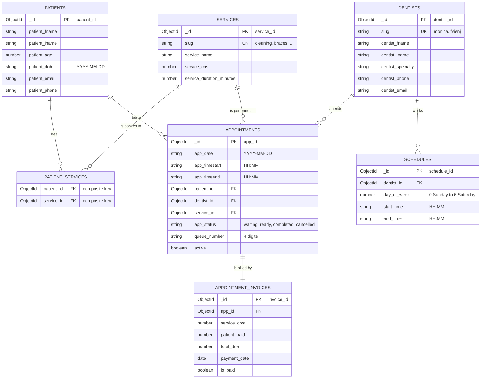

# Database design (MongoDB)

This is the MongoDB version of the clinic ERD. Each ERD table became one MongoDB **collection**,
and each foreign key (FK) became a field holding the other document's `_id` (an `ObjectId` reference).

> The diagram below is Mermaid. It renders on GitHub and in VS Code with a Mermaid preview extension.
> If it doesn't render for you, paste the code block into <https://mermaid.live>.

## ERD



## Collections and how they map to the ERD

| ERD table | MongoDB collection | Primary key | Model file |
|---|---|---|---|
| PATIENT | `patients` | `_id` (= `patient_id`) | `server/src/models/Patient.js` |
| DENTIST | `dentists` | `_id` (= `dentist_id`) | `server/src/models/Dentist.js` |
| SERVICES | `services` | `_id` (= `service_id`) | `server/src/models/Service.js` |
| PATIENT SERVICES | `patient_services` | `patient_id` + `service_id` (unique pair) | `server/src/models/PatientService.js` |
| APPOINTMENT | `appointments` | `_id` (= `app_id`) | `server/src/models/Appointment.js` |
| APPOINTMENT INVOICE | `appointment_invoices` | `_id` (= `invoice_id`) | `server/src/models/AppointmentInvoice.js` |
| SCHEDULE | `schedules` | `_id` (= `schedule_id`) | `server/src/models/Schedule.js` |
| *(contact form, not in the ERD)* | `messages` | `_id` | `server/src/models/Message.js` |

Field names are the same as in the ERD (`patient_fname`, `app_timestart`, ...).

### Class diagram names

The class diagram uses different names for some entities:

| Class diagram | In MongoDB |
|---|---|
| Patient, Services, Dentist | `patients`, `services`, `dentists` |
| Appoint Date | `appointments` |
| Service Appointed | `appointment_invoices` |
| Calendar | not stored; availability comes from `schedules` plus the existing `appointments` |
| Book Service Request | not stored; it is the booking request sent to `POST /api/bookings` |

## Differences from the ERD (and why)

| Change | Reason |
|---|---|
| Integer IDs became MongoDB `ObjectId`s (`_id`) | MongoDB generates them; there is no auto-increment. FK fields keep the ERD names (`patient_id`, `dentist_id`, ...) and store the referenced `_id`. |
| `appointments.queue_number` added | The 4-digit number patients use in "Check Queue". Unique only among active appointments, so numbers are reused once an appointment is completed or cancelled. |
| `appointments.active` added | Lets the database allow only one active appointment per dentist, date and time (partial unique index) while still keeping completed and cancelled history. |
| `appointments.app_timeend` added | From the class diagram. Calculated as start time + `service_duration_minutes`. |
| `services.service_duration_minutes` added | From the class diagram. |
| `slug` added to `services` and `dentists` | A short, stable key (`"cleaning"`, `"monica"`) that the website sends when booking. |
| `appointment_invoices.total_due` means the balance still owed | Starts equal to `service_cost`; becomes `service_cost - patient_paid` after payments. `is_paid` turns true when it reaches 0. |
| Invoice to appointment is one-to-one | One invoice per appointment, enforced by a unique index on `app_id`. |
| `patient_age` is calculated | From `patient_dob` when the patient is saved. |

## Why separate collections with references

The ERD describes data that is shared and changes on its own (a service price, a dentist's schedule, a patient with many
appointments). Keeping each in its own collection and referencing by `_id` avoids copying that data into every appointment.
Fields that must not change after the fact are copied on purpose: the invoice stores `service_cost` as it was at
booking time, so later price changes do not alter old invoices.

## Rules enforced by indexes

| Rule | Collection and index |
|---|---|
| A dentist can have only one active appointment per date and start time | `appointments`: unique `(dentist_id, app_date, app_timestart)` where `active` is true |
| A queue number is used by one active appointment at a time | `appointments`: unique `queue_number` where `active` is true |
| A patient is stored once per email and name | `patients`: unique `(patient_email, patient_fname, patient_lname)` |
| One invoice per appointment | `appointment_invoices`: unique `app_id` |
| One schedule row per dentist per weekday | `schedules`: unique `(dentist_id, day_of_week)` |
| One link per patient and service | `patient_services`: unique `(patient_id, service_id)` |

Indexes are created automatically when the server starts.

## What happens when someone books

1. The website sends the form to `POST /api/bookings`.
2. The server validates it, then finds the `services` and `dentists` documents by `slug`.
3. It checks the dentist's `schedules` row for that weekday and that the time fits the working hours.
4. It saves or updates the `patients` document (matched by email and name).
5. It inserts the `appointments` document with a new `queue_number` (the unique indexes reject a taken slot).
6. It inserts the matching `appointment_invoices` document and the `patient_services` link.

Example `appointments` document:

```json
{
  "_id": "6726f3a1c2d4e5f6a7b8c9d0",
  "app_date": "2026-11-03",
  "app_timestart": "14:00",
  "app_timeend": "15:00",
  "patient_id": "6726f3a1c2d4e5f6a7b8c9d1",
  "dentist_id": "6726f0b0c2d4e5f6a7b8c900",
  "service_id": "6726f0b0c2d4e5f6a7b8c910",
  "app_status": "waiting",
  "queue_number": "4821",
  "active": true
}
```

## Starting data

On the first start with an empty database the server inserts the 6 services, 2 dentists and their Monday to Saturday
8:00 AM to 5:00 PM schedules from `server/src/data/catalog.js`.

To change prices, durations, dentists or hours: edit `catalog.js`, then run `npm --prefix server run seed`.
This updates existing rows by `slug`; it does not delete anything. The dentist phone numbers in `catalog.js` are
placeholders (the clinic line), so replace them with the real numbers.

The Services page and booking form on the website still show their own list from `src/data/clinic.js`
(including price ranges such as "Php 20k - Php 40k"). The booking price comes from `service_cost` in the database,
so keep both in step when prices change.
